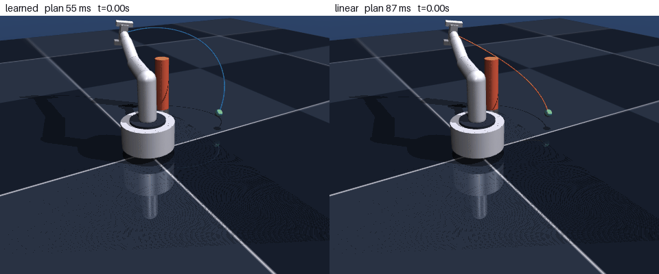
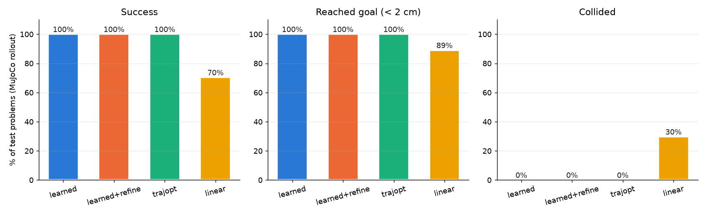

# MuJoCo Manipulator Learning

MuJoCo 시뮬레이션에서 4자유도 로봇팔과 그리퍼(`yang_manipulator.xml`)를 대상으로 여러 학습 기반 제어 방법을 실험하는 저장소입니다.

| 트랙 | 내용 | 문서 |
|---|---|---|
| Learned Trajectory Planning | 장애물을 피해 목표까지 가는 관절 궤적을 신경망이 생성합니다. MuJoCo 동역학으로 평가하고 시각화합니다. | [trajectory_planning/README.md](trajectory_planning/README.md) |
| Diffusion Policy | 궤적 수집, TemporalUNet + DDPM 학습, receding-horizon 실행, Domain Randomization 재학습으로 이어지는 6단계 파이프라인입니다. | [README_PIPELINE.md](README_PIPELINE.md) |
| RL baselines | PPO(PyTorch 구현)와 SAC(stable-baselines3)로 학습하고 Diffusion 정책과 비교합니다. | [README_PIPELINE.md](README_PIPELINE.md#추가-rl-baseline--ppo-proximal-policy-optimization) |

## Learned Trajectory Planning

시작 관절각, 목표 위치, 기둥 장애물이 주어지면 2초 길이의 B-spline 관절 궤적을 한 번에 출력합니다.
전문가 데모 없이 학습합니다. MuJoCo 모델에서 뽑아낸 미분 가능한 순기구학으로 궤적 비용(목표 오차, 충돌, 관절 한계, 가속도)을 계산해 직접 최소화합니다.



왼쪽은 학습 플래너로, 기둥 위로 넘어가 목표에 도달합니다. 오른쪽은 관절공간 직선 경로로, 기둥에 부딪힙니다.
얇은 선은 계획한 경로이고 굵은 선은 MuJoCo에서 실제로 추종한 경로입니다.

테스트 300문제를 MuJoCo 동역학(computed-torque 추종 제어)으로 실행한 결과입니다.

| 방법 | 성공률 | 충돌률 | 문제당 계획 시간 |
|---|---|---|---|
| learned (학습 플래너) | 100% | 0% | 67 ms |
| learned+refine (학습 결과 + 최적화 30 step) | 100% | 0% | 470 ms |
| trajopt (문제마다 최적화) | 100% | 0% | 5,685 ms |
| linear (IK + 관절공간 직선) | 70.3% | 29.7% | 83 ms |

학습 플래너는 문제마다 최적화하는 방식과 같은 성공률을 약 85배 빠르게 냅니다.
테스트 문제는 학습과 같은 분포(장애물 1개, 고정 크기)에서 뽑았습니다.



```bash
python trajectory_planning/train_planner.py          # 학습 (CPU 약 15분)
python trajectory_planning/evaluate_planner.py --n 300
python trajectory_planning/visualize_planner.py --start 7 --n 1 --methods learned linear
```

그래프와 지표 정의, 설계 과정은 [trajectory_planning/README.md](trajectory_planning/README.md)에 정리했습니다.

## Diffusion Policy와 RL baselines

```bash
python run_pipeline.py all                           # Step 1~6 전체 실행
python train_ppo.py --total_timesteps 50000          # PPO baseline
python evaluate_compare.py --diffusion_model models/diffusion_policy.pt \
    --diffusion_norm models/normalization.json --ppo_model models/ppo_policy.pt --episodes 10
```

단계별 설명, 헤드리스 서버 실행(`run_on_server.sh` / `.bat`), 문제 해결 방법은 [README_PIPELINE.md](README_PIPELINE.md)를 참고하세요.

## 저장소 구조

```
.mujoco/
├── trajectory_planning/          # 학습 기반 궤적 계획 (코드 + README)
├── models_tp/, results_tp/       # 궤적 계획 모델, 평가 결과, 그래프, GIF
├── manipulator_env.py            # Gymnasium 환경 (DomainRandomizedEnv)
├── collect_trajectories.py       # Diffusion Step 2: 데이터 수집
├── train_diffusion_policy.py     # Diffusion Step 3: TemporalUNet + DDPM 학습
├── validate_policy.py            # Diffusion Step 4: 검증
├── policy_node.py                # Diffusion Step 5: receding-horizon 실행
├── train_dr_policy.py            # Diffusion Step 6: Domain Randomization 재학습
├── train_ppo.py, train_sb3_sac.py, evaluate_compare.py, record_episodes.py
├── run_pipeline.py / .sh / .bat, run_on_server.sh / .bat
├── data/, models/, models_dr/, results/, trajectories/
└── mujoco200_win64/model/yang/yang_manipulator.xml   # 로봇 모델
```

## 설치

```bash
python -m pip install -r requirements.txt pillow
```

`mujoco` 3.x, `torch`, `gymnasium`, `numpy`, `scipy`, `matplotlib`가 필요합니다. 궤적 계획 트랙은 Python 3.14, MuJoCo 3.11, PyTorch 2.13(CPU)에서 확인했습니다.
모든 스크립트는 저장소 루트에서 실행합니다.

## 시각화 스크립트

- `visualize_manipulator.py`: 학습된 PPO 정책(`models/ppo_policy.pt`)을 MuJoCo 뷰어에서 실행합니다. `--condition domain_randomized`, `--model`, `--steps` 옵션이 있고, 뷰어를 열 수 없으면 텍스트 출력으로 대신합니다.
- `visualize_policy_sb3.py`: SAC 모델(`models/sac_manipulator.zip`, `train_sb3_sac.py`로 학습)을 실행합니다. `--render`를 주면 뷰어를 띄웁니다. stable-baselines3나 모델 파일이 없으면 랜덤 행동으로 장면만 보여 줍니다.
