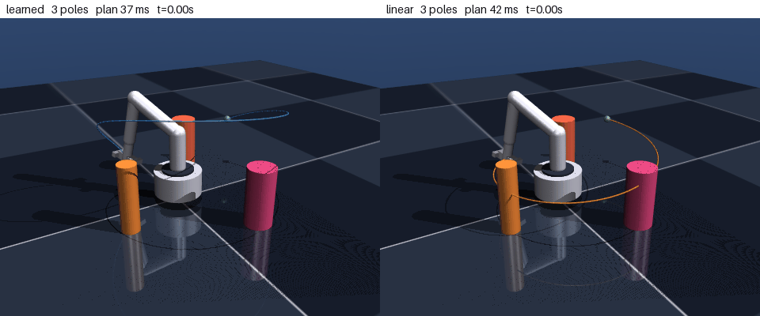
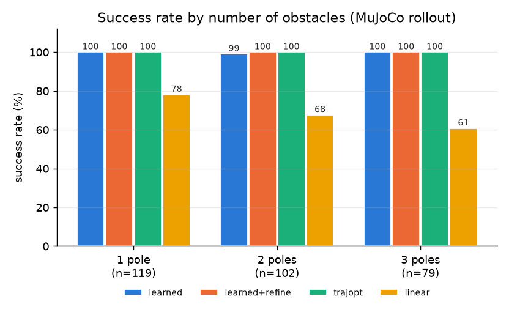

# MuJoCo Manipulator Learning

직접 모델링한 **4자유도 로봇팔(MJCF)** 위에 **Gymnasium RL 과제 환경 11종**을 만들고, SAC·PPO·TD3·A2C·HER로 **모델 31개를 학습·벤치마크**한 저장소입니다.
같은 로봇으로 만든 **충돌 회피 궤적 플래너**(자기지도 학습)와 그 플래너의 데모로 RL 정책을 학습한 **플래너 → RL 브리지**, **Diffusion Policy 파이프라인**도 담았습니다.
모든 지표는 MuJoCo 동역학 시뮬레이션(접촉 포함)에서 정책을 실제로 실행해 측정했습니다.

| Push-v0 / SAC | ReachMoving-v0 / SAC | HoldPose-v0 / PPO |
|---|---|---|
|  |  |  |

**핵심 RL 벤치마크** (학습 seed 3개, 각 20 에피소드 결정적 정책, 평균 ± 표준편차)

| 환경 | 과제 | 알고리즘 (steps) | 성공률 | 평균 리턴 | 무작위 정책 |
|---|---|---|---|---|---|
| `HoldPose-v0` | 0.5초마다 손목에 5~15 N 외력, 목표 자세 유지 | PPO (300k) | **88 ± 2%** (n=3) | 153 ± 6 | 0% |
| `Push-v0` | 바닥의 상자(6 cm)를 10~18 cm 떨어진 목표로 밀기 | SAC (100k) | **58 ± 8%** (n=3) | 186 ± 21 | 10% |
| `Reach-v0` | 무작위 목표 위치에 EE 도달 | SAC (100k) | **70 ± 11%** (n=3) | 349 ± 53 | 0% |
| `ReachDR-v0` | Reach + 질량·댐핑·마찰 ±20~30 %, 행동 스케일 ±15 %, 관측 노이즈 | SAC (100k) | **75 ± 8%** (n=3) | 366 ± 38 | 0% |
| `ReachMoving-v0` | 반지름 5~10 cm 원을 1~2 rad/s로 도는 목표 추적 | SAC (100k) | **90 ± 7%** (n=3) | 408 ± 21 | 0% |

그 외 과제의 최고 모델 (seed 1개): ReachSparse SAC+HER 65%, ReachObstacle SAC 30%, Lift SAC 35%, TrackTrajectory PPO 80%

## MuJoCo에서 직접 다룬 것

| 영역 | 구현 | 위치 |
|---|---|---|
| 로봇 모델링 | 4 DoF 팔 + 그리퍼 MJCF, 토크 모터 7개, `MjSpec`으로 장애물·물체를 코드에서 추가 | `assets/yang_manipulator.xml`, `envs/manipulator_tasks.py` |
| 동역학 제어 | `mj_fullM`·`qfrc_bias`·`qfrc_passive`로 computed-torque 제어기 | `trajectory_planning/tp_sim.py`, `rl_zoo/collect_planner_demos.py` |
| 접촉·충돌 | `d.contact` 기반 팔-장애물 접촉 판정, `mj_geomDistance`로 검증 (무작위 자세 400개 100% 일치) | `envs/`, `trajectory_planning/tp_sim.py` |
| 도메인 랜덤화 | 런타임 `body_mass`·`dof_damping`·`geom_friction`·`geom_size` 변경 | `ReachDR-v0`, `ReachMultiObstacle-v0` |
| 외란 | `xfrc_applied`로 손목에 주기적 외력 | `HoldPose-v0` |
| 기구학 | MuJoCo 기구학 체인을 추출한 PyTorch 미분 가능 순기구학 (MuJoCo 대비 1e-7 m) | `trajectory_planning/tp_core.py` |
| 시각화 | `mujoco.Renderer`로 GIF, `mujoco.viewer`로 인터랙티브 실행 | `envs/manipulator_tasks.py`(`render()`), `trajectory_planning/visualize_planner.py` |

---

## 1. RL 과제 환경 11종과 벤치마크

같은 로봇팔로 Gymnasium 과제 환경 11종을 만들었습니다(`envs/`, `gym.make("Yang/<id>")`).
도달·희소 보상·장애물 회피(기둥 1개 고정 / 기둥 1~3개 가변)·도메인 랜덤화·이동 목표·밀기·들기·궤적 추종·자세 유지·기존 물체 접근 환경이고,
한 베이스 클래스 위에서 `_task_reset / _obs / _reward / _success` 네 메서드로 과제를 정의합니다.


벤치마크에서 배운 것:

- 같은 벽시계 시간에서 off-policy(SAC)가 on-policy(PPO/A2C)보다 도달 과제를 훨씬 잘 풉니다. 반대로 매 step 보상이 밀도 있는 궤적 추종·자세 유지는 PPO가 더 좋았습니다.
- 희소 보상 도달은 예산을 3배로 늘려도 15%였지만 **HER(목표 재라벨링)**을 붙이자 65%가 됐습니다. 알고리즘 선택이 예산보다 중요했던 사례입니다.
- RL만으로는 장애물 회피 도달이 30%에 그칩니다(300k step). 같은 과제를 아래 2절의 학습 플래너는 99.7% 풉니다. 두 접근을 잇는 실험이 3절입니다.

전체 매트릭스(환경 11 × 알고리즘, 모델 31개)와 사용법: [rl_zoo/README.md](rl_zoo/README.md), 전체 평가 표: [results_zoo/zoo_summary.md](results_zoo/zoo_summary.md)

```bash
python envs/manipulator_tasks.py                      # 환경 11개 스모크 테스트
python rl_zoo/train_zoo.py --all --parallel 9         # 모델 매트릭스 학습
python rl_zoo/evaluate_zoo.py --episodes 20           # 전체 평가 표 + 그래프
python rl_zoo/visualize_zoo.py --run Reach-v0__SAC    # GIF (--viewer 로 MuJoCo 뷰어)
```

## 2. 학습 궤적 플래너 (자기지도, RL 아님)

RL이 30%에 머문 장애물 회피 도달을 다른 방식으로 풀었습니다. 보상 대신 **미분 가능한 궤적 비용을 경사하강으로 직접 최소화**하는 네트워크로,
장애물 사이에서 4자유도 팔의 충돌 없는 궤적을 100 ms 안에 만듭니다.



왼쪽은 학습 플래너, 오른쪽은 관절공간 직선 경로입니다. 얇은 선은 계획, 굵은 선은 MuJoCo에서 실제로 추종한 경로입니다.

| 방법 | 성공률 (300문제) | 기둥 3개일 때 | 문제당 계획 시간 |
|---|---|---|---|
| 관절공간 직선 (IK만) | 70.0% | 60.8% | 74 ms |
| 문제마다 궤적 최적화 (trajopt) | 100.0% | 100.0% | 7,253 ms |
| **학습 플래너 (이 저장소)** | **99.7%** | **100.0%** | **101 ms** |
| 학습 플래너 + 30 step 보정 | 100.0% | 100.0% | 475 ms |

### 문제

로봇팔이 시작 자세에서 목표 위치까지 가야 하는데, 사이에 기둥 장애물이 1~3개 있습니다(크기도 제각각).

- 가장 단순한 방법인 **IK + 관절공간 직선 보간**은 장애물을 보지 않아서 30%가 기둥에 부딪힙니다.
- **문제마다 궤적 최적화**(trajopt)는 전부 풀지만 한 문제에 6~7초가 걸려 실시간 사용이 불가능합니다.

목표는 "trajopt 수준의 성공률을 수십 ms 안에"입니다.

### 접근: 데모 없이 비용을 직접 최소화하는 궤적 생성 네트워크

(시작 관절각, 목표 위치, 장애물 집합) → 2초 길이 B-spline 관절 궤적(제어점 10개)을 **한 번의 forward**로 출력합니다.

1. MuJoCo 모델에서 기구학 체인과 충돌 형상을 자동으로 뽑아 **PyTorch 미분 가능 순기구학**을 만듭니다
   (MuJoCo 대비 위치 오차 1e-7 m, 충돌 구 근사는 `mj_geomDistance` 대비 1 cm 이내 보수적).
2. 궤적 비용 = 목표 오차 + 충돌 침투(안전여유 2 cm) + 관절 한계 + 가속도 + 속도. 전문가 데모 없이 이 비용으로 바로 학습합니다.
3. 무작위 문제 10만 개 풀에서 배치를 뽑아 3,000 iter 학습 (노트북 CPU 22분).

### 설계 결정과 그 근거

처음부터 지금 구조였던 게 아니라, 아래 순서로 실패하면서 바뀌었습니다. 수치는 모두 검증 성공률입니다.

| 단계 | 시도 | 결과 | 원인 분석 → 다음 결정 |
|---|---|---|---|
| 1 | MLP가 제어점 전체(끝 자세 포함)를 직접 출력 | **5%** | 목표 위치 정밀도가 cm 수준에서 멈춤. 회귀로 mm 정밀도를 내기 어려움 → 끝 자세를 **미분 가능한 DLS-IK 층**(해석적 자코비안, 5 step)으로 목표에 붙임 |
| 2 | IK 층 추가 | **60%** | 베이스를 관통하는 IK 분기에 갇힘. 분기 선택은 이산 문제라 경사하강으로 못 넘어감 → 분기는 **충돌 인지 IK**(랜덤 재시작, 가장 가까운 충돌 없는 해)로 정하고, 네트워크는 그 주변 보정과 **경로 형상(경유 제어점)**만 학습 |
| 3 | 역할 분리 | **100%** (기둥 1개, 고정 크기) | 분포가 좁음. 장애물 개수·크기가 바뀌면 입력 차원이 달라짐 → 기둥별 공유 MLP + max/mean 풀링 **집합 인코더** |
| 4 | 집합 인코더, 기둥 1~3개·크기 무작위 | **99.7%** (MuJoCo 300문제) | 기둥 1개 고정 분포에서도 99.7%로 성능 유지. 학습 전(출력층 0 초기화)에는 직선 경로와 같아서 학습이 무엇을 더했는지 분리해 볼 수 있음 |

**검증에서 신경 쓴 것**

- 지표는 운동학 모델이 아니라 **MuJoCo 동역학 롤아웃**(computed-torque 제어기, 토크 한계 포함)으로 계산합니다. 성공 = 최종 오차 2 cm 이내 + 접촉 0회.
- 기둥 3개를 최대 크기로 컴파일해 두고 문제마다 크기를 줄이는 방식이라, 컴파일 시 bounding volume이 항상 보수적입니다.
  무작위 자세 400개에서 접촉 플래그와 `mj_geomDistance < 0`이 100% 일치함을 확인했습니다.
- 샘플러와 IK가 결정적이라 평가·시각화 스크립트가 같은 문제 번호에 같은 궤적을 냅니다 (`--problems 4 19 29`).



### 한계와 다음 단계

- 장애물은 수직 기둥 최대 3개, 목표는 위치만(방향 없음). 상자형 장애물과 자세 목표는 SDF와 비용 항만 추가하면 됩니다.
- 회귀형 네트워크라 문제당 해가 하나입니다. 좌/우 우회 같은 다중 해는 Diffusion/CVAE 플래너로 후보를 뽑고 비용으로 고르면 됩니다.
- 계획 시간 101 ms 중 네트워크는 1 ms이고 나머지는 목표 IK(랜덤 재시작 24개)입니다. IK 재시작 수를 줄이거나 IK를 학습하면 수십 ms가 됩니다.
- 실제 로봇 이식은 하지 않았습니다. 그 전 단계로 RL 벤치마크의 도메인 랜덤화 환경(`ReachDR-v0`)이 있습니다.

상세(지표 정의, 그래프, 시각화 옵션, 파이썬 API): [trajectory_planning/README.md](trajectory_planning/README.md)

```bash
python trajectory_planning/train_planner.py                       # 학습 (CPU 약 22분)
python trajectory_planning/evaluate_planner.py --n 300             # MuJoCo 롤아웃 평가 + 그래프
python trajectory_planning/visualize_planner.py --problems 4 19 29 --methods learned linear   # GIF
python trajectory_planning/visualize_planner.py --viewer --methods learned trajopt           # 인터랙티브 뷰어
python trajectory_planning/simulate_planner.py --goal 0.35 -0.25 0.20 --obstacle 0.30 0.05 0.04 0.30 --viewer  # 임의 문제
```

## 3. 플래너 → RL 브리지 (`ReachMultiObstacle-v0`)

플래너의 문제 분포(기둥 1~3개, 크기 가변)를 그대로 쓰는 11번째 환경 `ReachMultiObstacle-v0`를 만들고,
플래너의 B-spline 궤적을 환경의 토크 행동으로 추종한 데모 2000개(`rl_zoo/collect_planner_demos.py`)로 정책을 학습했습니다.
같은 20문제에서 SAC 100k는 **0%**(최종 거리 11 cm), 순수 행동 복제는 **0%**였지만 — 전문가 행동이 관측에 없는 시작 자세·경과 시간에
의존해 라벨이 관측만으로 정해지지 않고, 작은 토크 오차가 적분되어 궤적을 벗어나기 때문 — 시간·q0 문맥을 붙이고 **DAgger**로 학습자가
방문한 상태를 플래너 추종기로 라벨링하자 **25%**(최종 거리 4.7 cm)가 됐습니다. 데모를 만든 플래너 자체는 같은 문제에서 100%이므로
남은 간극은 256×2 MLP가 강성 피드백 제어기를 근사하는 한계입니다. 표와 재현 명령: [results_zoo/planner_rl_bridge.md](results_zoo/planner_rl_bridge.md),
설명: [rl_zoo/README.md](rl_zoo/README.md#플래너-데모로-학습한-정책-reachmultiobstacle-v0).

| ReachMultiObstacle-v0 / BC + DAgger (25%) | ReachMultiObstacle-v0 / SAC 100k (0%) |
|---|---|
|  |  |

## 4. Diffusion Policy 파이프라인

궤적 수집 → TemporalUNet + DDPM 학습 → 검증 → receding-horizon 실행 → Domain Randomization 재학습의 6단계입니다.
자체 구현 PPO와 같은 환경에서 비교했습니다(10 에피소드 평균 리턴: PPO 157, Diffusion 37). 단계별 설명과 헤드리스 서버 실행은
[README_PIPELINE.md](README_PIPELINE.md)를 참고하세요.

```bash
python run_pipeline.py all                           # Step 1~6 전체 실행
python evaluate_compare.py --diffusion_model models/diffusion_policy.pt \
    --diffusion_norm models/normalization.json --ppo_model models/ppo_policy.pt --episodes 10
```

---

## 저장소 구조

```
.mujoco/
├── assets/yang_manipulator.xml   # 로봇 모델 (MJCF)
├── envs/                         # Gymnasium 과제 환경 11종 (manipulator_tasks.py), HER용 goal 래퍼, BC용 에피소드 문맥 래퍼
├── rl_zoo/                       # 벤치마크 학습/평가/시각화 + 플래너 데모 수집(collect_planner_demos)·BC/DAgger(train_bc)·브리지 비교(evaluate_bridge) + README
├── models_zoo/, results_zoo/     # zoo 모델(SB3), 평가 표, 그래프, GIF
├── trajectory_planning/          # 학습 궤적 플래너: tp_core(씬·FK·비용·네트워크), tp_sim(MuJoCo 추종·지표), train/evaluate/visualize/simulate
├── models_tp/, results_tp/       # 플래너 체크포인트, 평가 표, 그래프, GIF
├── manipulator_env.py            # 기존 Gymnasium 환경 (DomainRandomizedEnv)
├── collect_trajectories.py, train_diffusion_policy.py, validate_policy.py, policy_node.py, train_dr_policy.py
├── train_ppo.py, train_sb3_sac.py, evaluate_compare.py, record_episodes.py
├── run_pipeline.py / .sh / .bat, run_on_server.sh / .bat
└── data/, models/, models_dr/, results/, trajectories/
```

## 설치

```bash
python -m pip install -r requirements.txt
```

`mujoco` 3.x, `torch`, `gymnasium`, `stable-baselines3`, `numpy`, `scipy`, `matplotlib`, `pandas`, `pillow`가 필요합니다.
Python 3.14, MuJoCo 3.11, PyTorch 2.13(CPU), stable-baselines3 2.9에서 확인했습니다. 모든 스크립트는 저장소 루트에서 실행합니다.
MuJoCo는 pip 패키지만 쓰므로 별도 바이너리 설치나 라이선스 키가 필요 없습니다.

## 시각화 스크립트

- `rl_zoo/visualize_zoo.py`: zoo 모델 GIF / 뷰어 (`--all`로 전체).
- `trajectory_planning/visualize_planner.py`, `simulate_planner.py`: 플래너 GIF / 인터랙티브 뷰어 / 임의 문제 실행.
- `visualize_manipulator.py`: 자체 구현 PPO 정책(`models/ppo_policy.pt`)을 뷰어에서 실행. 뷰어를 열 수 없으면 텍스트 출력.
- `visualize_policy_sb3.py`: 기존 SAC 스크립트용. `--render`로 뷰어.
