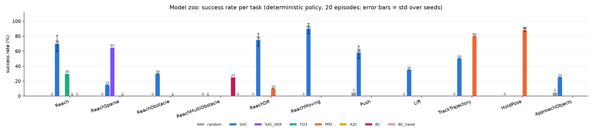
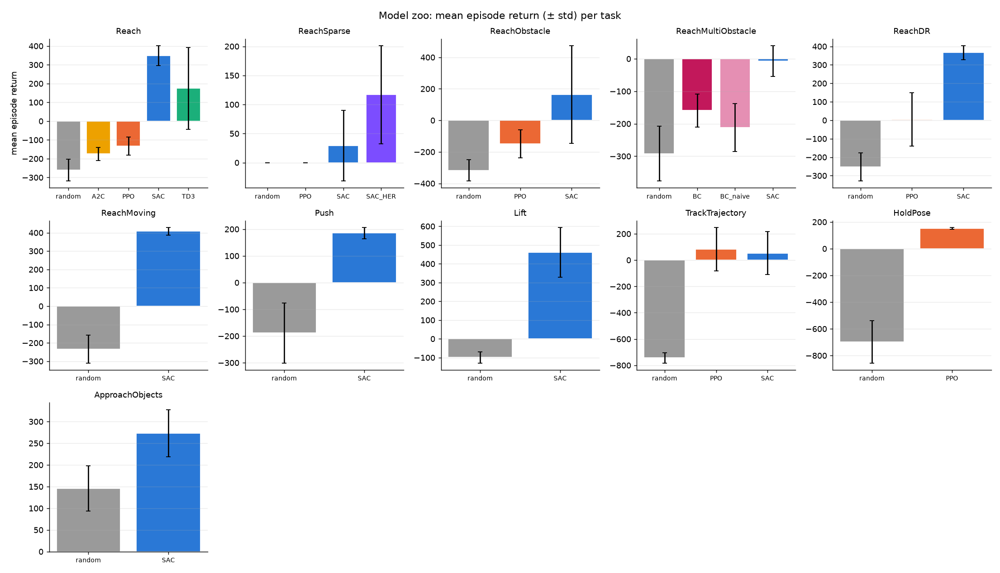
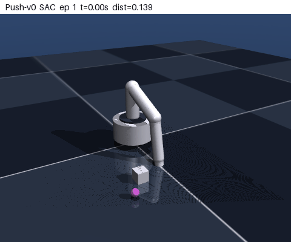
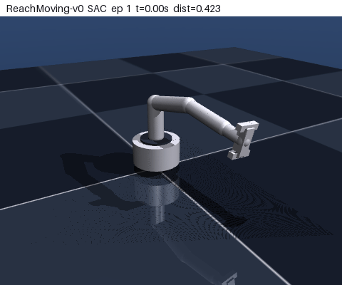
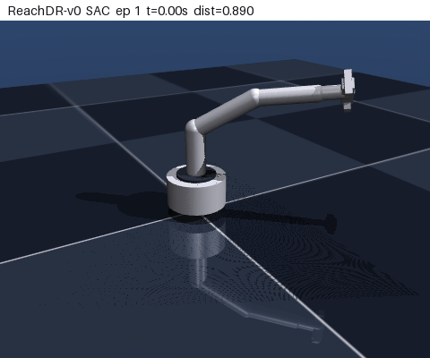
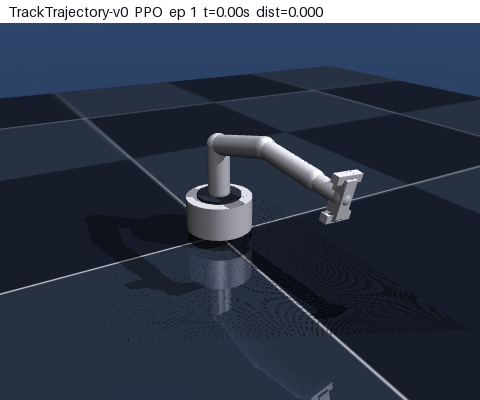
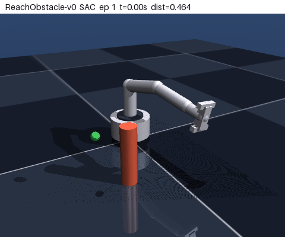
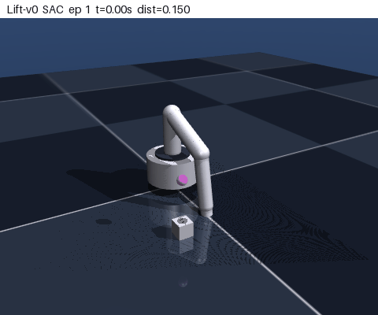
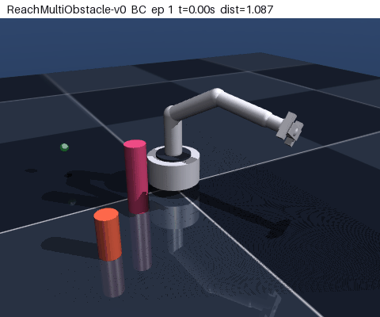
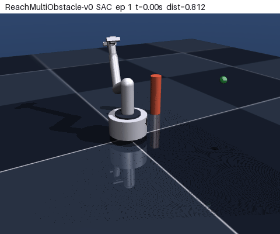

# RL Model Zoo (MuJoCo manipulator)

`yang_manipulator` 로봇팔용 **Gymnasium 과제 환경 11종**(`envs/`)과, 그 위에서 stable-baselines3로 학습한
**모델 모음**입니다. 하나의 명령으로 전체를 학습·평가·시각화할 수 있습니다.

## 환경 (`envs/manipulator_tasks.py`)

모든 과제는 같은 MuJoCo 모델을 쓰고 `ManipulatorTaskEnv`를 상속합니다. 제어 주기 10 ms(2 ms × frame_skip 5),
에피소드 200 step(2초), 행동은 팔 모터 토크 4개(-1~1, Lift만 그리퍼 1개 추가). `info`에는 항상
`success`, `dist`, `collision`이 들어갑니다.

| env id | 과제 | obs | act |
|---|---|---|---|
| `Reach-v0` | 무작위 목표 위치에 EE 도달 (dense 보상, 성공 3 cm) | 17 | 4 |
| `ReachSparse-v0` | Reach와 같은 과제, 희소 보상 (3 cm 안에서만 +1) | 17 | 4 |
| `ReachObstacle-v0` | 시작-목표 사이 기둥(4 cm × 30 cm)을 피해 도달, 접촉 시 패널티·실패 | 21 | 4 |
| `ReachMultiObstacle-v0` | 기둥 1~3개(반지름 3~7 cm, 높이 15~40 cm)를 피해 도달, 궤적 플래너와 같은 문제 분포(`tp_core.ProblemSampler`), 접촉 시 패널티·실패 | 29 | 4 |
| `ReachDR-v0` | Reach + 질량·댐핑·마찰 ±20~30 %, 행동 스케일 ±15 %, 관측 노이즈 | 17 | 4 |
| `ReachMoving-v0` | 반지름 5~10 cm 원을 1~2 rad/s로 도는 목표 추적 (성공 4 cm) | 20 | 4 |
| `Push-v0` | 바닥의 상자(6 cm)를 10~18 cm 떨어진 목표로 밀기 (성공 5 cm) | 26 | 4 |
| `Lift-v0` | 상자를 잡아 15 cm 이상 들기, 그리퍼 열기/닫기 포함 (행동 5) | 23 | 5 |
| `TrackTrajectory-v0` | 무작위 2초 관절 궤적 추종 (성공: 평균 오차 < 0.1 rad) | 21 | 4 |
| `HoldPose-v0` | 0.5초마다 손목에 5~15 N 외력, 목표 자세 유지 (성공: 마지막 0.5초 평균 오차 < 0.1 rad) | 19 | 4 |
| `ApproachObjects-v0` | 기존 DomainRandomizedEnv: 무작위 물체 2개에 접근, 토크 6, 동역학 랜덤화 | 38 | 6 |

```python
import gymnasium as gym, envs          # "Yang/<id>" 로 등록됨
env = gym.make("Yang/ReachObstacle-v0")
# 또는
from envs import make_env
env = make_env("Push-v0", render_mode="rgb_array")   # env.render() -> (400, 480, 3)
```

새 과제를 추가하려면 `ManipulatorTaskEnv`를 상속해 `_task_reset`, `_obs`, `_reward`, `_success`(필요하면 `_dist`,
`_task_step`)를 구현하고 `TASKS`에 등록하면 됩니다. 씬 구성은 클래스 속성 `keep_box`, `keep_obstacle`,
`gripper_action`, `randomize_dynamics`로 켭니다.

## 모델

`rl_zoo/zoo_config.py`의 `RUNS`가 학습 매트릭스(환경 × 알고리즘 × step 수)이고, `CORE`가 seed 3개로 돌리는 핵심 벤치마크입니다 (`--seeds 1 2`로 추가 seed 학습). 기본 예산은 노트북 CPU에서
전체가 1~1.5시간에 끝나도록 잡았습니다(SAC/TD3 100k step, PPO/A2C 300k step; 9개 병렬로 실측 85분, SAC 한 개 약 45분). 어려운 과제 ReachSparse·ReachObstacle·Lift는 300k step이고, ReachSparse에는 SAC+HER(`SAC_HER`, goal-conditioned 래퍼 `envs/goal_wrapper.py` + `HerReplayBuffer`, future 전략 4개 목표)를 추가했습니다. 더 강한 모델이 필요하면
`--timesteps`를 늘리면 됩니다.

20 에피소드 결정적 정책 평가, `random`은 무작위 행동 기준선입니다 (`python rl_zoo/evaluate_zoo.py` 결과, `results_zoo/zoo_summary.md`). 핵심 벤치마크 5개(Reach/ReachDR/ReachMoving SAC, Push SAC, HoldPose PPO)는 학습 seed 3개(0, 1, 2)의 평균 ± 표준편차이고 나머지는 seed 1개입니다. seed별 모델은 `models_zoo/<env>__<algo>__s<seed>/`에 있습니다.

| # | env | model | steps | seeds | success | mean return ± std | final dist (m) | collision | train (min) | 파일 |
|---|---|---|---|---|---|---|---|---|---|---|
|  | `Reach-v0` | random (기준선) | - | - | 0% | -260.2 ± 75.5 | 0.623 | 90% | - | - |
| 1 | `Reach-v0` | A2C | 300k | 1 | **0%** | -174.8 ± 34.5 | 0.400 | 0% | 8.9 | `models_zoo/Reach-v0__A2C/model.zip` |
| 2 | `Reach-v0` | PPO | 300k | 1 | **0%** | -133.4 ± 47.9 | 0.335 | 0% | 12.4 | `models_zoo/Reach-v0__PPO/model.zip` |
| 5 | `Reach-v0` | SAC | 100k | 3 | **70 ± 11%** | 349.5 ± 52.9 | 0.058 | 2% | 37.5 | `models_zoo/Reach-v0__SAC/model.zip` |
| 6 | `Reach-v0` | TD3 | 100k | 1 | **30%** | 174.5 ± 218.5 | 0.085 | 5% | 29.3 | `models_zoo/Reach-v0__TD3/model.zip` |
|  | `ReachSparse-v0` | random (기준선) | - | - | 0% | 0.0 ± 0.0 | 0.672 | 80% | - | - |
| 7 | `ReachSparse-v0` | PPO | 300k | 1 | **0%** | 0.0 ± 0.0 | 0.524 | 60% | 12.5 | `models_zoo/ReachSparse-v0__PPO/model.zip` |
| 8 | `ReachSparse-v0` | SAC | 300k | 1 | **15%** | 28.9 ± 60.7 | 0.293 | 40% | 110.3 | `models_zoo/ReachSparse-v0__SAC/model.zip` |
| 9 | `ReachSparse-v0` | SAC_HER | 300k | 1 | **65%** | 116.8 ± 84.5 | 0.055 | 5% | 118.1 | `models_zoo/ReachSparse-v0__SAC_HER/model.zip` |
|  | `ReachObstacle-v0` | random (기준선) | - | - | 0% | -305.2 ± 58.0 | 0.595 | 90% | - | - |
| 10 | `ReachObstacle-v0` | PPO | 300k | 1 | **0%** | -149.2 ± 88.0 | 0.323 | 25% | 12.5 | `models_zoo/ReachObstacle-v0__PPO/model.zip` |
| 11 | `ReachObstacle-v0` | SAC | 300k | 1 | **30%** | 163.9 ± 310.6 | 0.083 | 30% | 110.7 | `models_zoo/ReachObstacle-v0__SAC/model.zip` |
|  | `ReachMultiObstacle-v0` | random (기준선) | - | - | 0% | -291.9 ± 84.7 | 0.554 | 80% | - | - |
| 12 | `ReachMultiObstacle-v0` | BC | 1019k demo | 1 | **25%** | -159.3 ± 51.2 | 0.047 | 10% | 13.8 | `models_zoo/ReachMultiObstacle-v0__BC/model.pt` |
| 13 | `ReachMultiObstacle-v0` | BC_naive | 379k demo | 1 | **0%** | -211.2 ± 73.7 | 0.338 | 40% | 1.3 | `models_zoo/ReachMultiObstacle-v0__BC_naive/model.pt` |
| 14 | `ReachMultiObstacle-v0` | SAC | 100k | 1 | **0%** | -7.1 ± 47.8 | 0.110 | 15% | 20.8 | `models_zoo/ReachMultiObstacle-v0__SAC/model.zip` |
|  | `ReachDR-v0` | random (기준선) | - | - | 0% | -254.0 ± 59.4 | 0.646 | 85% | - | - |
| 12 | `ReachDR-v0` | PPO | 300k | 1 | **10%** | 4.6 ± 143.4 | 0.161 | 0% | 12.3 | `models_zoo/ReachDR-v0__PPO/model.zip` |
| 15 | `ReachDR-v0` | SAC | 100k | 3 | **75 ± 8%** | 366.3 ± 38.3 | 0.031 | 2% | 37.6 | `models_zoo/ReachDR-v0__SAC/model.zip` |
|  | `ReachMoving-v0` | random (기준선) | - | - | 0% | -262.0 ± 63.0 | 0.599 | 95% | - | - |
| 18 | `ReachMoving-v0` | SAC | 100k | 3 | **90 ± 7%** | 408.1 ± 20.9 | 0.042 | 5% | 37.2 | `models_zoo/ReachMoving-v0__SAC/model.zip` |
|  | `Push-v0` | random (기준선) | - | - | 10% | -156.4 ± 124.2 | 0.162 | 0% | - | - |
| 21 | `Push-v0` | SAC | 100k | 3 | **58 ± 8%** | 185.5 ± 21.0 | 0.064 | 0% | 37.6 | `models_zoo/Push-v0__SAC/model.zip` |
|  | `Lift-v0` | random (기준선) | - | - | 0% | -94.6 ± 55.2 | 0.150 | 0% | - | - |
| 22 | `Lift-v0` | SAC | 300k | 1 | **35%** | 461.5 ± 132.5 | 0.073 | 0% | 110.0 | `models_zoo/Lift-v0__SAC/model.zip` |
|  | `TrackTrajectory-v0` | random (기준선) | - | - | 0% | -747.9 ± 39.4 | 2.742 | 95% | - | - |
| 23 | `TrackTrajectory-v0` | PPO | 300k | 1 | **80%** | 83.4 ± 165.3 | 0.167 | 0% | 12.4 | `models_zoo/TrackTrajectory-v0__PPO/model.zip` |
| 24 | `TrackTrajectory-v0` | SAC | 100k | 1 | **50%** | 53.2 ± 162.5 | 0.196 | 0% | 42.5 | `models_zoo/TrackTrajectory-v0__SAC/model.zip` |
|  | `HoldPose-v0` | random (기준선) | - | - | 0% | -714.7 ± 120.0 | 2.354 | 85% | - | - |
| 27 | `HoldPose-v0` | PPO | 300k | 3 | **88 ± 2%** | 152.6 ± 6.5 | 0.045 | 0% | 11.0 | `models_zoo/HoldPose-v0__PPO/model.zip` |
|  | `ApproachObjects-v0` | random (기준선) | - | - | 10% | 144.6 ± 77.2 | 0.144 | 0% | - | - |
| 28 | `ApproachObjects-v0` | SAC | 100k | 1 | **25%** | 273.4 ± 54.3 | 0.100 | 0% | 39.4 | `models_zoo/ApproachObjects-v0__SAC/model.zip` |
| 29 | ApproachObjects-v0 | PPO (PyTorch 자체 구현) | - | - | - | 157.2 ± 62.6 | - | - | - | `models/ppo_policy.pt` (results/compare_results.csv 기록 (200 step 에피소드)) |
| 30 | ApproachObjects-v0 | Diffusion Policy (TemporalUNet+DDPM) | - | - | - | 37.0 ± 95.9 | - | - | - | `models/diffusion_policy.pt` (results/compare_results.csv 기록 (200 step 에피소드)) |
| 31 | ApproachObjects-v0 | Diffusion Policy + Domain Randomization | - | - | - | - | - | - | - | `models_dr/diffusion_policy_dr.pt` (평가 기록 없음) |
| 32 | TrajectoryPlanning (기둥 1~3개) | Learned Trajectory Planner (self-supervised) | - | - | 99.7% | - | 0.0001 | 0.3% | - | `models_tp/planner.pt` (results_tp/eval_summary.json, 300문제 MuJoCo 롤아웃) |

총 35개 모델 (SB3 zoo 28개 = 18개 (env, algo) 조합 × seed + 플래너 데모 BC 2개 + 기존 4개). `BC`/`BC_naive`의 steps 열은 학습에 쓴 전이 수입니다.





### 시각화 예시 (`results_zoo/videos/`)

| Push-v0 / SAC (70%) | ReachMoving-v0 / SAC (80%) | HoldPose-v0 / PPO (90%) |
|---|---|---|
|  |  |  |

| Reach-v0 / SAC (55%) | ReachDR-v0 / SAC (75%) | TrackTrajectory-v0 / PPO (80%) |
|---|---|---|
|  |  |  |

| ReachSparse-v0 / SAC+HER (65%) | ReachObstacle-v0 / SAC 300k (30%) | Lift-v0 / SAC 300k (35%) |
|---|---|---|
|  |  |  |

화면 위: 과제·알고리즘·에피소드·시각·목표 거리. 마지막 0.5초: SUCCESS/FAIL, 리턴, 최종 거리.

## 플래너 데모로 학습한 정책 (`ReachMultiObstacle-v0`)

RL만으로는 장애물 회피 도달이 `ReachObstacle-v0`(기둥 1개 고정)에서 SAC 300k로 30%에 그쳤습니다. 반면 같은 로봇의
학습 궤적 플래너(`trajectory_planning/`)는 기둥 1~3개 문제를 99.7% 풉니다. 두 트랙을 잇기 위해

1. 플래너의 문제 분포를 그대로 쓰는 환경 **`ReachMultiObstacle-v0`**를 추가했습니다. 씬(`tp_core.build_model`)과 문제
   (`tp_core.ProblemSampler`: 기둥 1~3개, 반지름 3~7 cm, 높이 15~40 cm)를 플래너 코드에서 가져오고, 관측은 `ReachObstacle-v0`의
   `q, qd/10, ee, goal, goal-ee`에 기둥 3슬롯 × (x, y, r, h)(빈 슬롯 0)를 붙인 29차원, 보상·성공(3 cm 이내 + 접촉 0회)은
   `ReachObstacle-v0`와 같습니다. `env.reset(options={"problem": (q0, goal, obstacles)})`로 특정 문제를 재생할 수 있습니다.
2. **플래너 데모 수집** (`rl_zoo/collect_planner_demos.py`): 문제 2000개의 B-spline 궤적을 `plan_learned`로 계산하고
   `SimScene.rollout` 대신 환경의 `step()`으로 추종합니다. 매 10 ms마다 `SimScene._control`과 같은 computed-torque 식으로
   토크를 구해 모터 gear로 나눈 값([-1, 1])을 action으로 기록하므로 (obs, action)이 환경의 공간과 같습니다
   (`data/planner_demos.npz`, 1997 에피소드 / 399k 전이; 환경 step으로 추종해도 플래너는 100% 성공).
3. **정책 학습** (`rl_zoo/train_bc.py`): MLP(256×2)로 (obs → action) 회귀.

| 정책 (`ReachMultiObstacle-v0`, 같은 20문제) | 성공률 | 충돌률 | 최종 거리 |
|---|---|---|---|
| 무작위 행동 | 0% | 90% | 50.9 cm |
| SAC 100k (`models_zoo/ReachMultiObstacle-v0__SAC`) | **0%** | 15% | 11.0 cm |
| 순수 BC (obs → action, `__BC_naive`) | **0%** | 40% | 33.8 cm |
| **BC + DAgger (obs + 시간·q0 문맥, `__BC`)** | **25%** | 10% | 4.7 cm |
| 학습 플래너 + computed torque (env.step, 데모 생성기) | 100% | 0% | 0.0 cm |
| 학습 플래너 (`SimScene.rollout`, 참고) | 100% | 0% | 0.0 cm (계획 70 ms/문제) |

전체 표와 재현 명령: [`results_zoo/planner_rl_bridge.md`](../results_zoo/planner_rl_bridge.md) (`python rl_zoo/evaluate_bridge.py`).

| ReachMultiObstacle-v0 / BC + DAgger (25%; 왼쪽 GIF: 기둥 2개 성공, 이어서 3.2 cm 근접 실패) | ReachMultiObstacle-v0 / SAC 100k (0%) |
|---|---|
|  |  |

**순수 BC가 0%였던 이유와 해결.** 데모 행동의 검증 MSE는 3e-5(행동 표준편차의 2%)로 작았지만 닫힌 루프 성공률은 0%였습니다.
전문가는 "(q0, goal, 장애물)로 계획한 궤적을 **시계에 맞춰** 추종하는 제어기"라서, 행동이 관측에 없는 두 정보(시작 자세 q0, 경과 시간)에
의존합니다. 같은 관측에 다른 라벨이 붙으니 관측만 보는 정책은 되돌리는 피드백을 배울 수 없고, 토크 오차가 적분되어 궤적에서 벗어납니다
(DART식 실행 노이즈 0.1~0.3, 경로 추종형 참조점으로 바꿔도 0~5%). 그래서

- `envs/episode_context_wrapper.py`: 관측에 정규화 시간 k/200과 q0를 붙입니다(SB3 `TimeFeatureWrapper`처럼 에피소드 이력의
  결정적 함수이므로 정책은 여전히 반응형입니다). 이것만으로는 10%: 자기 오차가 누적된 상태는 데모에 없기 때문입니다.
- **DAgger** (`--dagger N`, 기본 4): 현재 정책으로 새 문제를 롤아웃하면서 방문한 모든 상태에 전문가(같은 computed-torque 추종기)의
  행동을 라벨로 붙여 데이터에 합치고 다시 학습합니다. 학습자 롤아웃 성공률이 0 → 4 → 17 → 26 → 27 → 32 → 32 → 34%(회당 400 에피소드)로 올라갑니다
  (`models_zoo/ReachMultiObstacle-v0__BC/learning_curve.png`).

```bash
python rl_zoo/collect_planner_demos.py                                   # 플래너 데모 2000문제 -> data/planner_demos.npz (약 2분)
python rl_zoo/train_bc.py                                                # BC + DAgger -> models_zoo/ReachMultiObstacle-v0__BC (약 14분)
python rl_zoo/train_bc.py --dagger 0 --no-context --run ReachMultiObstacle-v0__BC_naive --algo-label BC_naive   # 순수 BC 대조군
python rl_zoo/train_zoo.py --env ReachMultiObstacle-v0 --algo SAC        # SAC 100k (약 21분)
python rl_zoo/evaluate_bridge.py --episodes 20                           # 비교 표 -> results_zoo/planner_rl_bridge.md
python rl_zoo/visualize_zoo.py --run ReachMultiObstacle-v0__BC           # GIF
```

남은 간극(25% vs 플래너 100%)은 256×2 MLP로 kp=400 강성 피드백을 근사하는 데서 옵니다. DAgger 반복을 늘리거나,
정책이 토크 대신 다음 목표 관절각을 내고 computed-torque 층을 두거나, SAC을 이 데모로 초기화(RL fine-tuning)하는 것이 다음 단계입니다.

## 실행

저장소 루트에서 실행합니다. 의존성: `mujoco gymnasium stable-baselines3 torch numpy matplotlib pandas pillow`

```bash
# 환경 스모크 테스트 (11개 환경을 무작위 정책으로 한 에피소드씩)
python envs/manipulator_tasks.py

# 학습: 하나 / 전체 매트릭스(병렬)
python rl_zoo/train_zoo.py --env Reach-v0 --algo SAC --timesteps 100000
python rl_zoo/train_zoo.py --all --parallel 9

# 평가: 모든 모델 + 무작위 기준선 -> results_zoo/zoo_summary.md, zoo_success.png, zoo_returns.png
python rl_zoo/evaluate_zoo.py --episodes 20

# 시각화: GIF (headless OK) / 인터랙티브 MuJoCo 뷰어 / 전체 모델 GIF
python rl_zoo/visualize_zoo.py --run Reach-v0__SAC --episodes 2
python rl_zoo/visualize_zoo.py --run Push-v0__SAC --viewer
python rl_zoo/visualize_zoo.py --all
```

### 학습된 모델을 직접 쓰기

```python
import sys; sys.path.insert(0, ".")
from stable_baselines3 import SAC
from envs import make_env

env = make_env("Reach-v0", render_mode="rgb_array")
model = SAC.load("models_zoo/Reach-v0__SAC/model.zip", device="cpu")
obs, info = env.reset(seed=0)
for _ in range(200):
    action, _ = model.predict(obs, deterministic=True)
    obs, reward, terminated, truncated, info = env.step(action)
    frame = env.render()                     # MuJoCo 오프스크린 렌더 (RGB)
print(info["success"], info["dist"])
```

## 출력물

| 경로 | 내용 |
|---|---|
| `models_zoo/<env>__<algo>/model.zip` | SB3 모델 (`config.json`: 환경·알고리즘·하이퍼파라미터·학습 시간, `eval.json`: 학습 직후 20 에피소드) |
| `models_zoo/<env>__<algo>/monitor.csv`, `learning_curve.png` | 학습 중 에피소드 리턴·성공률 곡선 |
| `results_zoo/zoo_summary.md`, `zoo_summary.json` | 전체 모델 평가 표 (무작위 기준선, 기존 모델 포함) |
| `results_zoo/zoo_success.png`, `zoo_returns.png` | 과제별 성공률 / 평균 리턴 |
| `results_zoo/videos/*.gif` | 모델별 MuJoCo 렌더링 |
| `data/planner_demos.npz` | 플래너 데모 (obs, actions, episode_starts, 문제·제어점·에피소드 통계) |
| `results_zoo/planner_rl_bridge.md`, `.json` | `ReachMultiObstacle-v0`에서 무작위 / SAC / BC / BC+DAgger / 플래너 비교 |
| `models_zoo/ReachMultiObstacle-v0__BC/model.pt` | BC+DAgger 정책 (torch; `config.json`의 `algo: "BC"`, `episode_context: true`) |

## 한계

- 학습 예산이 작아서(SAC 100k, PPO 300k step) 결과는 "동작하는 베이스라인" 수준입니다. Reach도 SAC 55%에서 아직 상승 중입니다
  (`models_zoo/Reach-v0__SAC/learning_curve.png`). 어려운 세 과제는 300k step으로 늘려 ReachSparse 0% → SAC 15% / SAC+HER 65%,
  ReachObstacle 0% → 30%, Lift 0% → 35%가 됐습니다. 희소 보상에는 예산보다 HER(목표 재라벨링)이 훨씬 효과적이었습니다.
  더 올리려면 더 긴 학습, 커리큘럼이 필요합니다. 장애물 과제는 궤적 플래너와 결합했습니다(위 "플래너 데모로 학습한 정책" 절:
  플래너 분포의 `ReachMultiObstacle-v0`에서 SAC 100k 0% → 플래너 데모 BC+DAgger 25%, 플래너 자체 100%).
- on-policy(PPO/A2C)는 같은 벽시계 시간에 off-policy(SAC/TD3)보다 샘플 효율이 크게 낮아 도달 과제에서 거의 학습하지 못했습니다.
  반면 TrackTrajectory·HoldPose처럼 보상이 매 step 밀도 있게 주어지는 과제는 PPO가 더 잘 풀었습니다.
- Push/Lift에서는 바닥 접촉이 정상 동작이라 `collision`에서 제외했습니다. 다른 과제는 팔(링크2 이후)과 바닥·기둥 접촉을 충돌로 셉니다.
- 환경 자체의 보상/성공 조건은 단순한 형태라 과제별 튜닝 여지가 큽니다.
