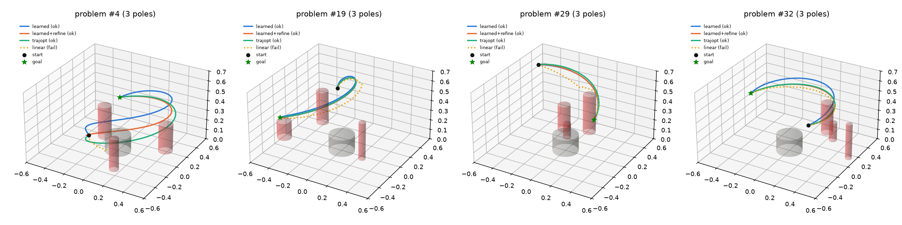

# Learned Trajectory Planning (MuJoCo)

`yang_manipulator.xml` 로봇팔(4 DoF 팔 + 그리퍼)이 **시작 관절각 → 목표 위치**까지
**기둥 장애물(1~3개, 크기 가변)·바닥·베이스와 충돌 없이** 이동하는 관절 궤적을 신경망이 한 번의 forward로 생성하도록 학습하고,
MuJoCo 동역학 시뮬레이션에서 성능을 평가·시각화합니다.

> v2 (현재): 장애물 1~3개, 반지름 3~7 cm, 높이 15~40 cm 무작위. 장애물 집합 인코더로 개수에 상관없이 처리합니다.
> v1: 장애물 1개, 4 cm × 30 cm 고정. v1 분포는 `--obstacles 1 1 --fixed-size` 옵션으로 그대로 재현할 수 있습니다.

## 문제 정의

| 입력 | 출력 |
|---|---|
| 시작 관절각 `q0` (4), 목표 EE 위치 `goal` (xyz), 장애물 `obstacles` (최대 3개 × [x, y, 반지름, 높이]) | 2초 길이 관절 궤적 `q(t)` |

- 궤적 표현: clamped cubic **B-spline** (제어점 10개). `c0=c1=q0`, `c8=c9=q_end`로 고정해서 시작·끝 속도가 0입니다.
- 장애물: 수직 기둥. 문제마다 개수를 1~3에서 균일하게 뽑고, 각 기둥의 반지름(3~7 cm)과 높이(15~40 cm)도 무작위입니다.
  첫 번째 기둥은 절반의 확률로 "관절공간 직선 경로" 위에 놓여 단순 경로를 실제로 가로막습니다. 나머지 기둥은 직선 경로 위 또는 작업공간 안 임의 위치입니다.
  기둥끼리 겹치지 않고, 목표·시작 EE 위치는 기둥 옆 9 cm 이상 떨어지거나 기둥 위에 있어야 합니다.
- 문제 샘플링: 시작 자세와 목표 자세(목표 위치를 만드는 자세)가 둘 다 충돌이 없는 경우만 사용합니다.
- 장애물 텐서는 `(B, 3, 4)`이고 높이가 0인 슬롯은 비어 있습니다. 비용·네트워크·MuJoCo 씬 모두 이 마스크를 공유합니다.

## 학습 방법 (self-supervised, 데모 불필요)

1. MuJoCo 모델에서 기구학 체인과 충돌 구(geom → sphere 근사)를 자동으로 뽑아 **미분 가능한 순기구학(PyTorch)**을 만듭니다.
   MuJoCo `xpos`와의 오차는 1e-7 m 수준이고, 구 근사 거리와 `mj_geomDistance`의 차이는 1 cm 미만(보수적)입니다 (`python trajectory_planning/tp_core.py`로 확인).
2. 궤적 비용 = 목표 오차 + 충돌 침투(안전여유 2 cm, 모든 기둥/베이스/바닥 SDF의 최소값) + 관절 한계 + 가속도 + 속도.
3. 목표 위치의 **충돌 인지 IK 해 `q_ik`**(DLS IK + 랜덤 재시작, 시작 자세에 가장 가까운 충돌 없는 해)를 먼저 구합니다.
4. `PlannerNet`은 기둥마다 공유 MLP(128)로 인코딩한 뒤 활성 기둥에 대해 max/mean 풀링(순서 불변, 개수 무관)하고,
   전역 특징 `(q0, goal, q_ik, 시작 EE)`와 이어 붙여 MLP(512×4)에 넣습니다. 출력은 `q_end` 보정량과 **경유 제어점 오프셋**입니다.
   `q_end`는 **미분 가능한 DLS-IK 층**(해석적 자코비안, 5 스텝)을 거쳐 목표에 정확히 붙습니다.
   출력층이 0으로 초기화되어 있어서, 학습 전 네트워크는 `linear` 기준선과 같은 궤적을 냅니다.
5. 문제 10만 개와 그 IK 해를 미리 계산한 풀에서 512개씩 배치를 뽑아 비용을 직접 최소화합니다(3000 iter).

> 설계 메모: 처음에는 MLP가 IK까지 직접 출력하게 했는데, 목표 정밀도가 cm 수준에 머물렀습니다(성공률 약 5%).
> IK 층을 넣은 뒤에도 베이스를 관통하는 IK 분기에 갇히는 문제가 남았습니다(성공률 약 60%). IK 분기 선택은
> 이산적인 문제라 경사하강으로 넘어가기 어렵습니다. 그래서 분기는 충돌 인지 IK로 정하고, 네트워크는 경로 형상을 학습하도록 역할을 나눴습니다.
> v2에서는 장애물 입력을 고정 길이 벡터가 아니라 집합으로 바꿔, 기둥 개수가 달라져도 같은 네트워크를 씁니다.

## 비교 방법 (평가)

| 이름 | 설명 |
|---|---|
| `learned` | 목표 IK + 신경망 1회 forward |
| `learned+refine` | 신경망 출력을 초기값으로 같은 비용을 30 step 최적화 |
| `trajopt` | 문제마다 같은 비용을 처음부터 최적화 (초기값 4개 × 400 step). 품질 기준선 |
| `linear` | 충돌 인지 IK 후 관절공간 직선 보간 (경로상 장애물 무시). 하한 기준선 |

모든 궤적은 MuJoCo에서 **computed-torque 제어기**(질량행렬 + 중력/코리올리 보상 + PD, 액추에이터 한계로 클리핑)로 추종합니다.
지표는 **실제 시뮬레이션 결과**로 계산합니다.

- **success**: 최종 EE 오차 < 2 cm 이고 로봇(링크2 이후)이 기둥·바닥·베이스와 한 번도 접촉하지 않음
- final EE error, 기둥 최소거리(`mj_geomDistance`, 모든 활성 기둥), EE 경로 길이, 계획 궤적의 적분 제곱 jerk, 추종 RMSE, 토크 포화 비율
- planning latency: 문제 1개를 단독으로 계획할 때 걸린 시간

MuJoCo 씬은 기둥 3개를 최대 크기로 컴파일해 두고 문제마다 `geom_size`/`body_pos`를 바꿉니다. 빈 슬롯은 `contype=0`으로 끄고 숨깁니다.
(최대 크기로 컴파일하므로 컴파일 시 만들어진 bounding volume이 항상 보수적이고, 400개 무작위 자세에서 접촉 플래그와 `mj_geomDistance<0`이 100% 일치함을 확인했습니다.)

## 실행

저장소 루트(`.mujoco/`)에서 실행합니다. 의존성: `mujoco>=3.2 torch numpy scipy matplotlib pillow`

```bash
# 1) 학습 (CPU 약 20분). 빠른 확인은 --iters 300 --pool 8192
python trajectory_planning/train_planner.py
# 2) 평가: 테스트 문제 × 4개 방법을 MuJoCo로 롤아웃 (아래 결과는 --n 300)
python trajectory_planning/evaluate_planner.py --n 300
# 3) 시각화 (아래 "시각화" 절 참고)
python trajectory_planning/visualize_planner.py --problems 4 19 29 --methods learned linear
```

`--obstacles LO HI`(기둥 개수 범위, 기본 `1 3`)와 `--fixed-size`(v1 기둥 4 cm × 30 cm)는 세 스크립트에 공통입니다.
`evaluate_planner.py`와 `visualize_planner.py`는 기본 seed(2026)와 샘플러 옵션이 같으면 같은 테스트 문제를 사용합니다.
샘플러와 IK는 결정적이라서 문제 개수나 배치 크기가 달라도 같은 문제에 같은 궤적이 나옵니다.

## 시각화

### 1) 테스트 문제를 방법별로 나란히 GIF로 저장 (headless OK)

```bash
# 평가 CSV의 problem=4, 19, 29(기둥 3개, 직선 경로 실패)를 learned / linear 두 화면으로 저장 -> results_tp/videos/problem_XXX_learned_vs_linear.gif
python trajectory_planning/visualize_planner.py --problems 4 19 29 --methods learned linear
# 네 방법 모두, 0번부터 3문제
python trajectory_planning/visualize_planner.py --start 0 --n 3 --methods learned learned+refine trajopt linear
```

오프스크린 렌더러(`mujoco.Renderer`)를 쓰므로 GPU·디스플레이가 없어도 동작합니다.
화면 위에는 방법 이름, 기둥 개수, 계획 시간, 시각이 표시되고, 마지막 0.5초에 SUCCESS / COLLISION / MISSED GOAL과 최종 오차·최소 거리가 뜹니다.
얇은 선은 계획한 EE 경로, 굵은 선은 MuJoCo에서 실제로 추종한 EE 경로, 초록 구는 목표, 색 기둥은 장애물입니다.

### 2) 인터랙티브 MuJoCo 뷰어로 실시간 재생 (GUI 필요)

```bash
python trajectory_planning/visualize_planner.py --viewer --problems 4 19 --methods learned trajopt
```

`mujoco.viewer.launch_passive`로 창을 띄우고 문제 × 방법 순서로 실시간 재생합니다. 마우스로 시점을 돌릴 수 있고 창을 닫으면 끝납니다.
각 재생이 끝나면 터미널에 성공 여부·오차·최소 거리가 출력됩니다.

### 3) 평가 그래프

`evaluate_planner.py`가 `results_tp/`에 저장합니다. 성공률 막대(`summary_rates.png`), 기둥 개수별 성공률(`success_by_obstacles.png`),
지표 분포(`distributions.png`), 직선 경로가 실패한 문제의 실제 EE 경로 3D(`example_paths_3d.png`), 계획 vs 실제 관절각(`tracking_example.png`).

## 학습된 모델을 MuJoCo에서 직접 사용하기

### 명령줄: 원하는 목표·장애물로 바로 실행

```bash
# 시작 관절각(도), 목표 위치(m), 기둥(x y 반지름 높이, 최대 3개)을 지정해 MuJoCo로 추종. 결과를 터미널에 출력
python trajectory_planning/simulate_planner.py --q0 0 0 0 0 --goal 0.35 -0.25 0.20 \
    --obstacle 0.30 0.05 0.04 0.30 --obstacle 0.15 -0.30 0.05 0.25
# 같은 문제를 뷰어에서 보기 / GIF로 저장 / 직선 기준선과 비교
python trajectory_planning/simulate_planner.py --goal 0.35 -0.25 0.20 --obstacle 0.30 0.05 0.04 0.30 --viewer
python trajectory_planning/simulate_planner.py --goal 0.35 -0.25 0.20 --obstacle 0.30 0.05 0.04 0.30 \
    --methods learned linear --gif results_tp/videos/custom.gif
# 계획한 관절 궤적(t, q, qd, qdd, 제어점)을 npz로 저장 -> 다른 제어기/실제 로봇에서 추종
python trajectory_planning/simulate_planner.py --goal 0.35 -0.25 0.20 --save-npz plan.npz
```

시작 자세가 충돌 상태이거나 목표가 학습 작업공간(반지름 0.22~0.62 m, 높이 0.05~0.45 m) 밖이면 경고를 출력합니다.

### 파이썬 API

```python
import sys; sys.path.insert(0, "trajectory_planning")
import numpy as np, torch
from tp_core import TrajectoryCost, load_planner, plan_learned
from tp_sim import SimScene

sim = SimScene()                                   # MuJoCo 모델(기둥 3개 + 목표 마커) + computed-torque 제어기
net, cfg = load_planner("models_tp/planner.pt", sim.kin)
cost = TrajectoryCost(sim.kin, cfg)

q0 = torch.zeros(1, 4)                             # 시작 관절각 (rad)
goal = torch.tensor([[0.35, -0.25, 0.20]])         # 목표 EE 위치 (m)
obs = torch.zeros(1, 3, 4)                         # (배치, 슬롯 3개, [x, y, 반지름, 높이]); 높이 0 = 빈 슬롯
obs[0, 0] = torch.tensor([0.30, 0.05, 0.04, 0.30])

ctrl, plan_time = plan_learned(net, cost, q0, goal, obs)        # B-spline 제어점 (1, 10, 4)
metrics, log = sim.rollout(ctrl[0].numpy(), cost.basis, q0[0].numpy(), goal[0].numpy(), obs[0].numpy())
print(metrics["success"], metrics["final_err_mm"], metrics["min_obstacle_dist_cm"])
# log["t"], log["q_des"] (계획), log["q"] (실제), log["ee"] (실제 EE 경로)
```

`sim.rollout(..., frame_cb=f)`를 주면 매 프레임 `f(t, ee_history)`가 호출되므로 자체 렌더링이나 로깅을 붙일 수 있습니다
(`visualize_planner.py`가 이 방식으로 GIF와 뷰어를 만듭니다).
궤적을 자체 제어기로 추종하려면 `cost.basis.matrix(s, deriv) @ ctrl_pts`로 임의 시각 `s=t/2초`의 q, qd, qdd를 얻습니다.

## 결과 (MuJoCo 동역학 롤아웃, 테스트 300문제, seed 2026)

기둥 개수 1~3 균일, 반지름 3~7 cm, 높이 15~40 cm 무작위. 기둥 개수별 문제 수: 1개 119, 2개 102, 3개 79

| method | success | collision | median err (mm) | median clearance (cm) | median jerk | track RMSE (deg) | latency (ms) |
|---|---|---|---|---|---|---|---|
| learned | **99.7%** | 0.3% | 0.13 | 8.48 | 164.4 | 0.10 | **101.3** |
| learned+refine | 100.0% | 0.0% | 0.85 | 4.95 | 115.4 | 0.09 | 475.4 |
| trajopt | 100.0% | 0.0% | 0.81 | 5.08 | 114.3 | 0.08 | 7253.1 |
| linear | 70.0% | 30.0% | 0.12 | 4.69 | 2576.9 | 4.91 | 74.3 |

기둥 개수별 성공률

| method | 1 pole (n=119) | 2 poles (n=102) | 3 poles (n=79) |
|---|---|---|---|
| learned | 100.0% | 99.0% | 100.0% |
| learned+refine | 100.0% | 100.0% | 100.0% |
| trajopt | 100.0% | 100.0% | 100.0% |
| linear | 78.2% | 67.6% | 60.8% |

- 학습 플래너는 직선 경로가 실패하는 30%의 문제를 거의 모두 풀었습니다(300문제 중 1건 접촉).
  문제별 최적화(trajopt)와 같은 수준의 성공률을 **약 72배 빠르게** 냅니다. `learned+refine`(30 step 최적화)은 100.0%입니다.
- 직선 기준선은 기둥이 늘수록 급격히 나빠지지만(78.2% → 60.8%) 학습 플래너는 기둥 3개에서도 100.0%입니다.
- 학습 플래너는 trajopt보다 기둥과 거리를 더 두고(중앙값 8.5 cm 대 5.1 cm) 경로가 약간 깁니다. `learned+refine`이 그 차이를 줄여 줍니다.
- learned 지연시간의 대부분은 목표 IK이고, 네트워크 forward는 약 1 ms입니다. 지연시간은 노트북 CPU에서 문제 10개를 단독 호출한 중앙값이라 실행마다 수십 % 차이가 납니다(GIF의 plan 시간은 60~90 ms).
- 학습 곡선: 학습 전(iter 0, 직선 경로와 동일) 검증 성공률 68.8%에서 100 iter 만에 99%를 넘고, best 체크포인트(iter 2200)는 99.9%입니다(`models_tp/training_curves.png`).

### v1 분포(기둥 1개, 4 cm × 30 cm 고정)에서의 성능

같은 모델을 v1 테스트 분포 300문제에서 평가한 결과입니다(`evaluate_planner.py --obstacles 1 1 --fixed-size`, `results_tp/v1_distribution/`).

| method | success | collision | median clearance (cm) | latency (ms) |
|---|---|---|---|---|
| learned (v2 모델) | 99.7% | 0.3% | 8.76 | 79.2 |
| linear | 71.7% | 28.3% | 5.58 | 71.2 |

v1 모델(기둥 1개 전용)은 같은 분포에서 300문제 100%였습니다. 일반화 범위를 넓히면서 단일 기둥 성능은 유지했습니다.




## 출력물

| 경로 | 내용 |
|---|---|
| `models_tp/planner.pt` | 검증 성공률 기준 best 체크포인트 (`planner_last.pt`는 마지막). v2 형식(`version: 2`) |
| `models_tp/training_curves.png`, `train_history.json`, `train_log.txt` | 비용 항목별 학습 곡선, 검증 성공률(전체·기둥 개수별)·목표 오차 |
| `results_tp/eval_summary.md`, `eval_summary.json`, `eval_results.csv` | 방법별 요약(기둥 개수별 포함) / 문제×방법 단위 원시 지표 |
| `results_tp/summary_rates.png`, `success_by_obstacles.png` | 성공률·목표 도달률·충돌률, 기둥 개수별 성공률 |
| `results_tp/distributions.png` | 오차, 기둥 거리, 경로 길이, jerk, 추종 오차, 계획 시간 분포 |
| `results_tp/example_paths_3d.png` | 직선 경로가 실패한 문제에서 방법별 실제 EE 경로 (3D, 기둥 포함) |
| `results_tp/tracking_example.png` | 계획 vs MuJoCo 실제 관절각 |
| `results_tp/videos/*.gif` | MuJoCo 렌더링 (얇은 선 = 계획 경로, 굵은 선 = 실제 경로) |

## 파일 구성

- `tp_core.py`: 씬 구성(MjSpec으로 기존 XML 로드 → 자유 물체 제거, 기둥 3개·목표 마커 추가), 미분 가능 FK/자코비안, B-spline, 비용(장애물 집합 SDF), 문제 샘플러, 집합 인코더 네트워크, 플래너들
- `tp_sim.py`: MuJoCo 추종 제어기, 문제별 기둥 배치, 접촉/거리 지표, 렌더링 헬퍼
- `train_planner.py`, `evaluate_planner.py`, `visualize_planner.py`, `simulate_planner.py`

## 한계와 확장 아이디어

- 장애물은 수직 기둥 최대 3개이고 목표는 위치만 있습니다(방향 없음). 상자 등 다른 형태는 SDF와 샘플러에 추가하면 됩니다.
  슬롯 수(`MAX_OBS`)를 늘리면 네트워크 구조 변경 없이 더 많은 장애물을 다룰 수 있습니다(재학습 필요).
- 회귀형 네트워크는 문제마다 해를 하나만 냅니다(좌/우 우회 같은 다중 해 중 하나). Diffusion/CVAE 플래너로 여러 후보를 샘플링하고
  비용으로 고르면 성공률을 더 올릴 수 있습니다. 기존 `train_diffusion_policy.py`와 연결할 수 있는 지점입니다.
- `learned+refine`처럼 학습 플래너를 최적화의 warm-start로 쓰면 짧은 시간 안에 trajopt 수준 품질에 가까워집니다.
- `learned` 지연시간의 대부분은 목표 IK(약 65 ms)입니다. IK 재시작 수를 줄이거나 IK도 학습하면 더 빨라집니다.
